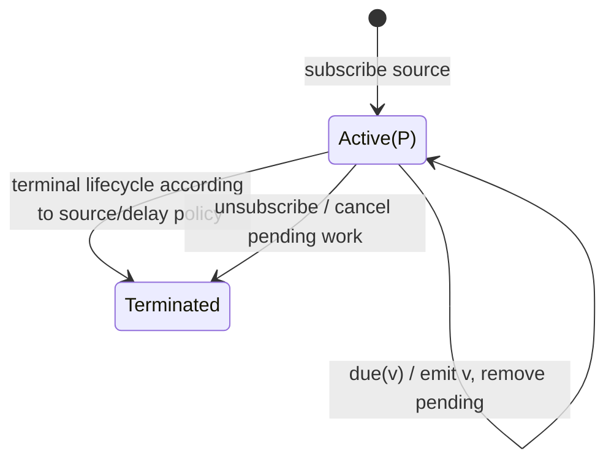

# delay

## Semantic essence

`delay` preserves each source value while moving its downstream delivery to a later scheduled time. It separates source occurrence time from observer delivery time.

## Classification

- Family: temporal placement
- Policy: deferred delivery
- Memory: pending scheduled deliveries
- Reference: relative duration or absolute Date
- Value transformation: none

## Core BDD

```text
Given delay is active
When a source value arrives
Then associate the value with its configured delivery time
And retain it as pending
And schedule later delivery
And emit nothing immediately

Given a source value is pending
When its scheduled due time arrives
Then remove it from the pending set
And emit the value to the sink
```

## Mealy machine



## Formal view

For fixed delay `Delta`:

```text
deliveryTime(v) = occurrenceTime(v) + Delta
```

## Domain DSL

`deliverAfter(duration)` / `shiftBy(duration)`

## Semantic fingerprint

**receive now -> schedule delivery -> retain -> release when due**
