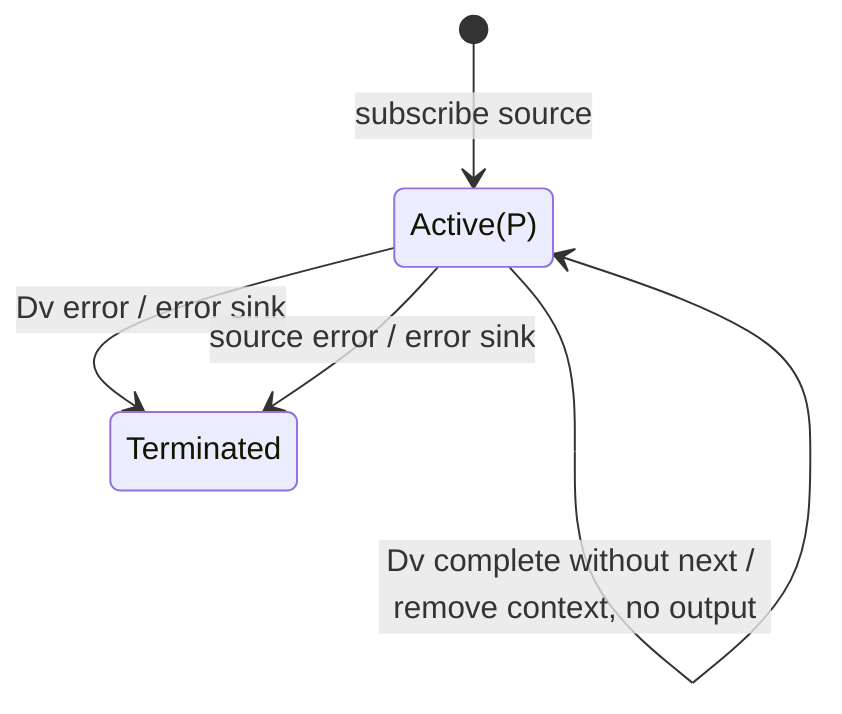

# delayWhen

## Semantic essence

`delayWhen` gives each source value an independent release lifecycle. A selector creates a duration Observable for the value; the source value is retained until that duration emits a `next` notification.

## Classification

- Family: temporal placement
- Policy: per-value release gating
- Memory: active set of value-duration contexts
- Release: corresponding duration `next`
- Ordering: may differ from source ordering

## Core BDD

```text
Given delayWhen is active
When a source value arrives
Then invoke delayDurationSelector(value,index)
And retain the value
And subscribe to its duration Observable
And emit nothing immediately

Given value v is pending
When its duration Observable emits next
Then emit v
And remove its pending context
And unsubscribe that duration

Given a duration completes without next
Then remove the context without emitting its source value

Given a duration errors
Then error the output
```

## Mealy machine



## Domain DSL

`releaseWhen(selector)`

## Semantic fingerprint

**value -> private duration -> retain -> duration next -> release**
