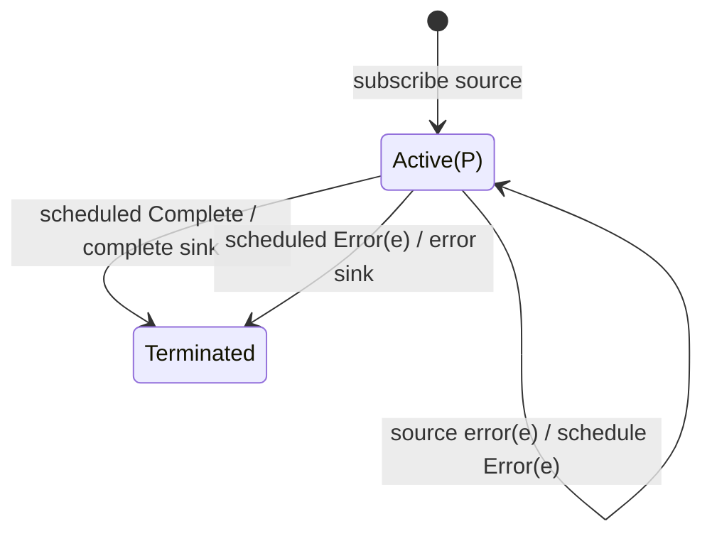

# observeOn

## Semantic essence

`observeOn` introduces a downstream scheduler boundary. Source notifications are received under the source's existing execution policy, rescheduled using the configured scheduler, and then delivered downstream.

## Classification

- Family: scheduler control
- Controlled entity: notifications
- Direction: downstream
- Notifications: next, error, complete
- Source internal scheduling: not replaced

## Core BDD

```text
Given observeOn is active
When the source emits next(v)
Then schedule downstream delivery of next(v) on the configured scheduler

Given the source completes
Then schedule the completion notification

Given the source errors
Then schedule the error notification

Given a scheduled notification executes
Then deliver that same notification downstream
```

## Mealy machine



## Domain DSL

`deliverOn(scheduler)`

## Semantic fingerprint

**upstream notification -> scheduler boundary -> downstream notification**
