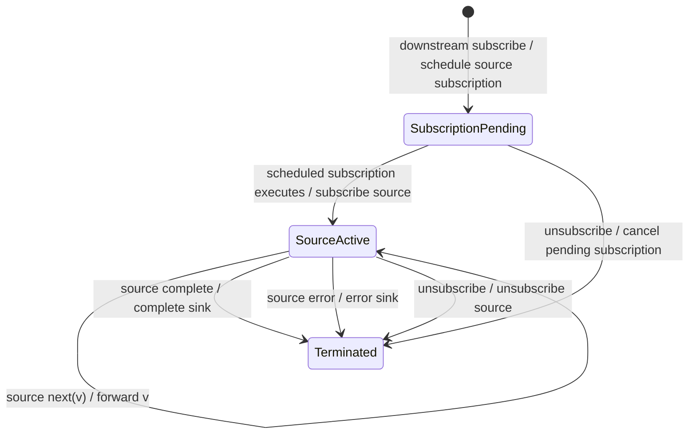

# subscribeOn

## Semantic essence

`subscribeOn` schedules the act of subscribing to the source on a configured scheduler. Until that scheduled action executes, the source has not yet been subscribed.

## Classification

- Family: scheduler control
- Controlled entity: source subscription
- Direction: upstream/source activation
- State: subscription pending, then source active

## Core BDD

```text
Given the source is not yet subscribed
When a downstream subscriber subscribes
Then schedule the source-subscription action on the configured scheduler
And do not subscribe to the source immediately

Given source subscription is scheduled
When the scheduler executes that action
Then subscribe to the source
And enter the source-active state
```

## Mealy machine



## Domain DSL

`beginOn(scheduler)`

## Semantic fingerprint

**subscription requested -> schedule subscription -> source begins**
