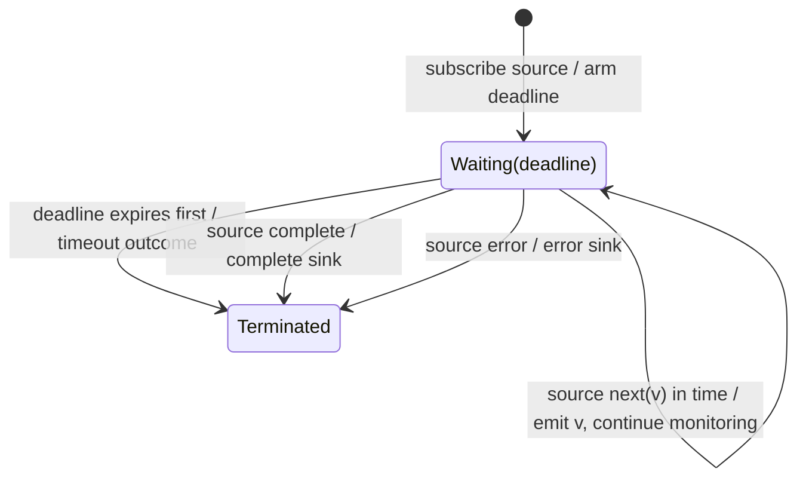

# timeout

## Semantic essence

`timeout` supervises source activity against a temporal deadline. Activity that arrives within the permitted time continues normally; if the deadline wins first, the configured timeout outcome is triggered.

## Classification

- Family: temporal supervision
- State: armed temporal expectation
- Competition: source activity vs deadline
- Success: source activity in time
- Failure: deadline expires first

## Core BDD

```text
Given source activity is being supervised
And the deadline has not expired
When the required source value arrives
Then emit the value
And continue normal supervision

Given required source activity has not occurred
When the configured deadline expires
Then trigger the timeout policy
```

## Mealy machine



## Conceptual distinction

```text
delay   = post-arrival temporal policy
timeout = pre-arrival temporal requirement
```

## Domain DSL

`requireWithin(duration)`

## Semantic fingerprint

**arm deadline -> race expected activity -> deadline loss triggers timeout**
