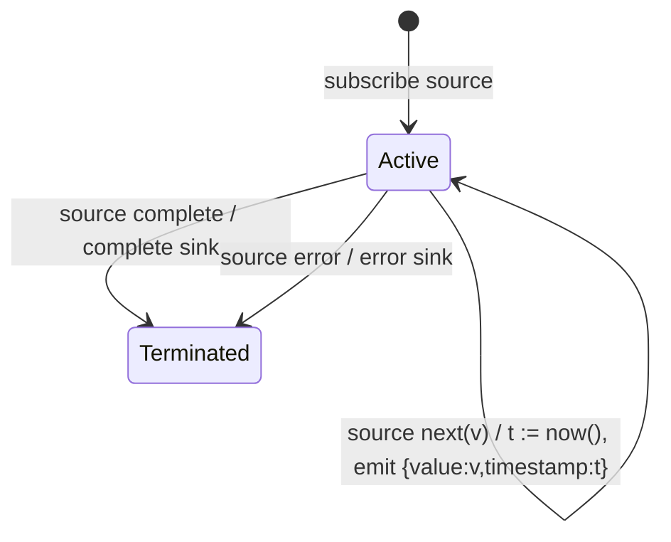

# timestamp

## Semantic essence

`timestamp` samples a configured clock for every source value and emits an enriched structure containing the original value and the absolute clock reading.

## Classification

- Family: temporal measurement
- Policy: absolute-time annotation
- Memory: no previous-time history
- Clock: TimestampProvider.now()

## Core BDD

```text
Given timestamp is subscribed
When a source value arrives
Then obtain the current time from the configured timestamp provider
And emit the source value together with that timestamp
```

## Mealy machine



## Formal view

```text
v_i -> (v_i, t_i)
```

## Domain DSL

`withTimestamp()` / `annotateTime()`

## Semantic fingerprint

**source value -> sample clock -> attach absolute temporal coordinate**
