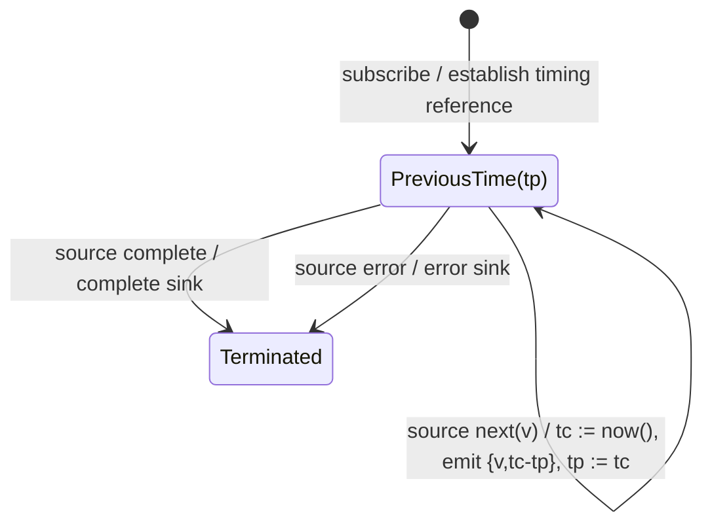

# timeInterval

## Semantic essence

`timeInterval` measures relative temporal distance. At each source emission it reads the clock, subtracts the previous timing reference, emits the value with the elapsed interval, and stores the current time as the next reference.

## Classification

- Family: temporal measurement
- Policy: relative-time annotation
- Memory: previous-time register
- Clock: scheduler.now()

## Core BDD

```text
Given a previous timing reference exists
When a source value arrives
Then obtain the current time
And compute currentTime - previousTime
And emit the source value with that interval
And replace previousTime with currentTime
```

## Mealy machine



## Formal view

```text
v_i -> (v_i, t_i - t_(i-1))
```

## Domain DSL

`withElapsedTime()`

## Semantic fingerprint

**clock + previous-time register -> inter-emission delta as data**
