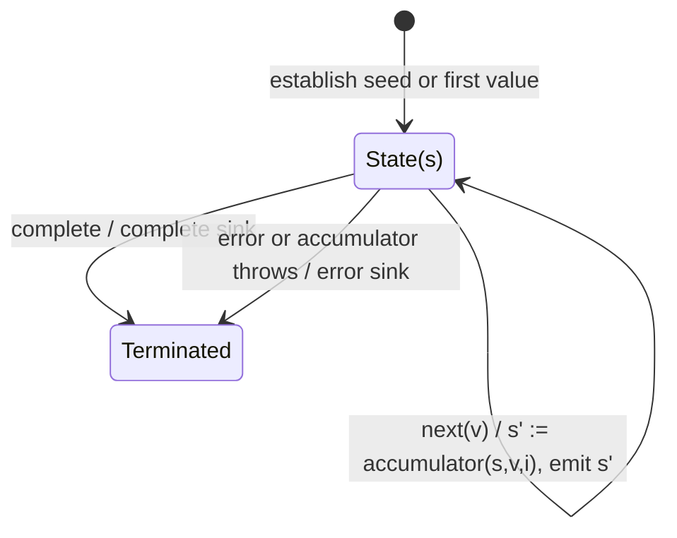

# scan

## Semantic essence

`scan` maintains accumulated state, updates that state for each source value through an accumulator, emits every resulting state, and retains the emitted state for the next transition.

## Core BDD

```text
Given accumulated state s exists
When source value v arrives
Then calculate s' = accumulator(s,v,index)
And replace the accumulated state with s'
And emit s'
```

Without a seed, the first source value establishes the initial state and is emitted directly.

## Mealy machine



## Formal model

```text
S0 = seed
S(n+1) = f(Sn, xn)
output = S1, S2, S3, ...
```

## Domain DSL

`evolveState(reducer, initialState)`

## Semantic fingerprint

**event -> transition -> next state -> emit -> feedback**
