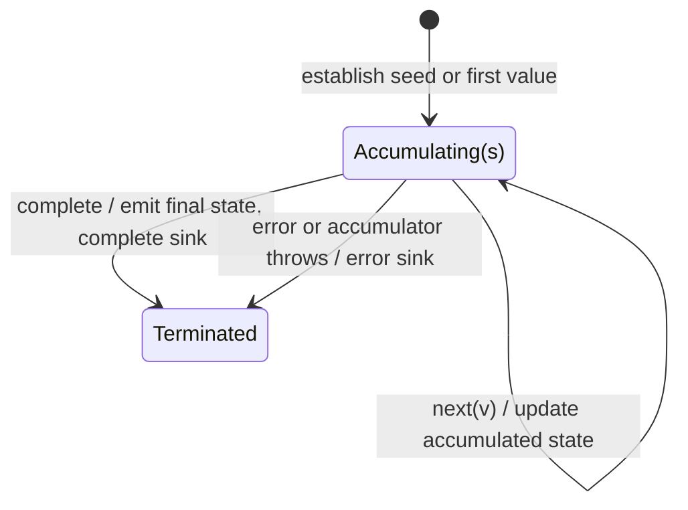

# reduce

## Semantic essence

`reduce` uses the same broad accumulation recurrence as `scan` but retains intermediate states privately and emits only the final accumulated result when the source completes.

## Core BDD

```text
Given accumulated state s exists
When source value v arrives
Then calculate s' = accumulator(s,v,index)
And retain s'
And emit nothing

Given final accumulated state s exists
When the source completes
Then emit s
And complete
```

## Mealy machine



## Domain DSL

`summarize(reducer, initial)`

## Semantic fingerprint

**event -> private state update -> completion -> expose final state**
