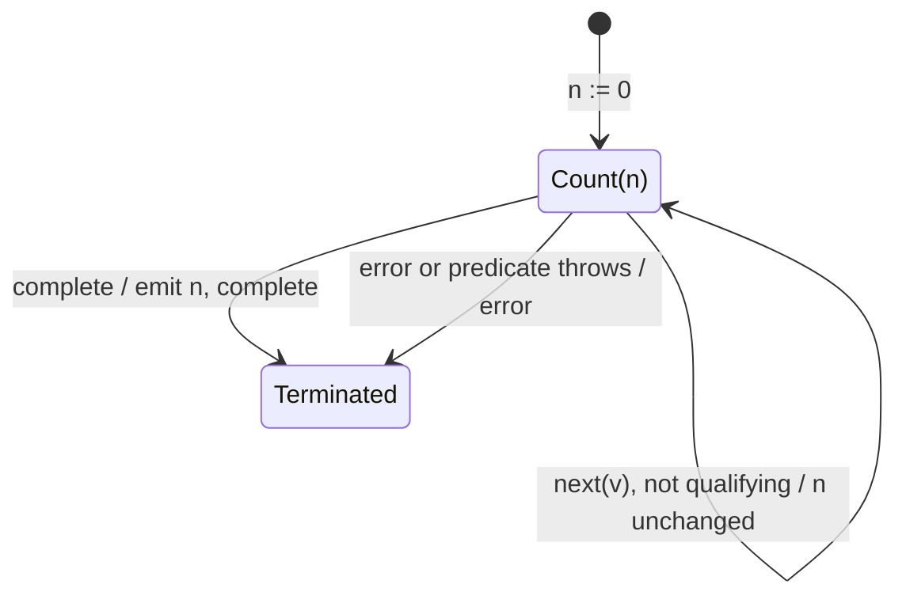

# count

## Semantic essence

`count` is specialized terminal accumulation with an integer state. Every source value, or every value satisfying an optional predicate, increments the private counter. Completion exposes the final count.

## Core BDD

```text
Given current count is n
When source value v arrives
Then evaluate the optional predicate
And if v qualifies set count := n + 1
And otherwise retain n
And emit nothing

When the source completes
Then emit the final count
And complete
```

## Mealy machine



## Formal view

```text
count(P) = sum_i indicator(P(x_i))
```

## Domain DSL

`countMatching(predicate)` / `countAll()`

## Semantic fingerprint

**qualification + private integer accumulation + terminal visibility**
