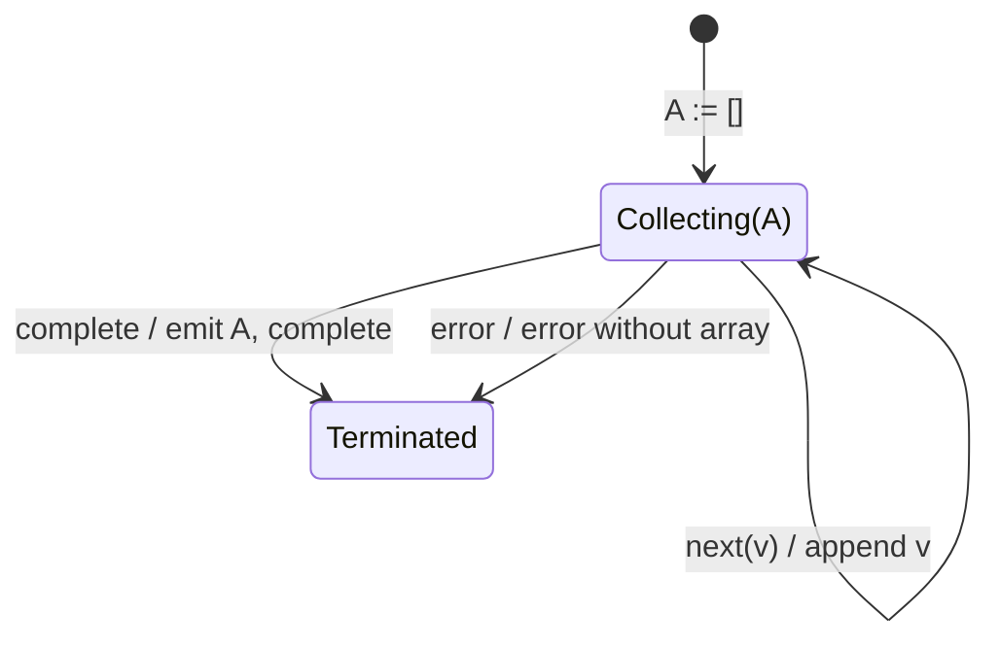

# toArray

## Semantic essence

`toArray` accumulates every source value in emission order into a private array and emits the complete array once when the source completes.

## Core BDD

```text
Given accumulated array A exists
When source value v arrives
Then append v to A
And emit nothing

When the source completes
Then emit A
And complete
```

## Mealy machine



## Interpretation

```text
N temporal notifications
        ->
one ordered collection containing N values
```

## Domain DSL

`collectAll()`

## Semantic fingerprint

**retain complete ordered history + completion -> materialize history**
