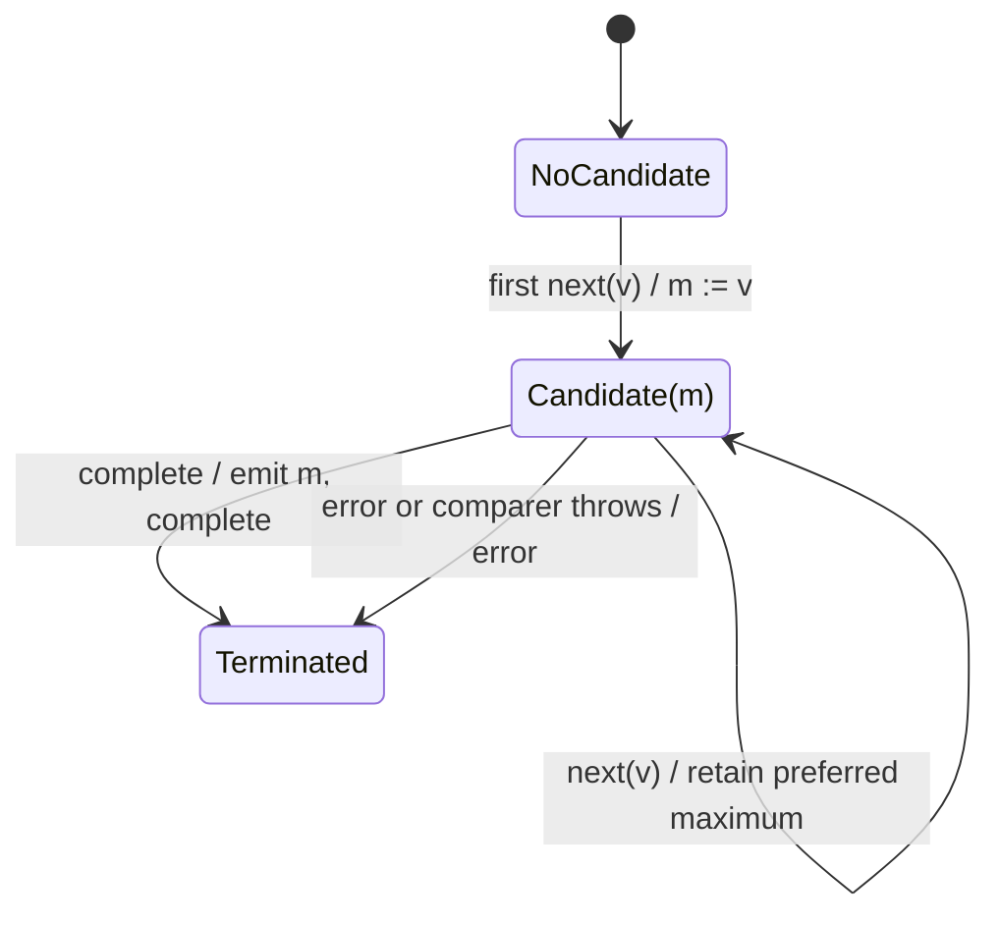

# max

## Semantic essence

`max` maintains one largest-so-far candidate according to its ordering policy and exposes the surviving maximum when the source completes.

## Core BDD

```text
Given no candidate exists
When the first source value arrives
Then retain it as the candidate

Given candidate m exists
When source value v arrives
Then retain the larger of m and v according to the comparer
And emit nothing

When the source completes
Then emit the retained candidate
And complete
```

## Mealy machine



## Domain DSL

`selectMaximum(comparer)`

## Semantic fingerprint

**one query-sufficient candidate + prefer higher + terminal visibility**
