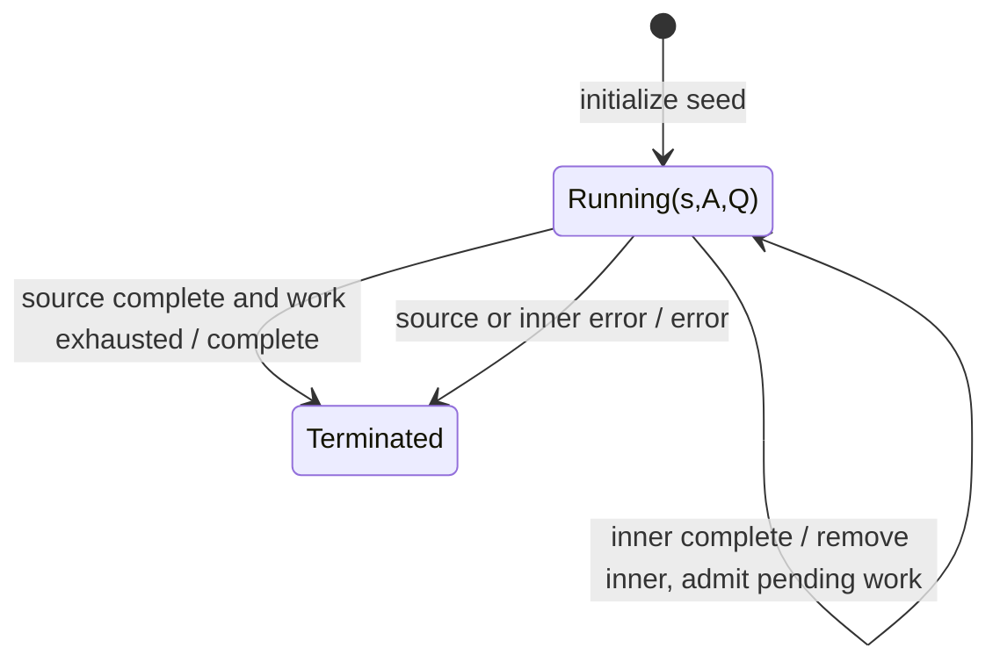

# mergeScan

## Semantic essence

`mergeScan` combines accumulated-state feedback with merge-style higher-order execution. The accumulator maps current state and each source value to an Observable of states. Inner emissions are emitted and become accumulated state.

## Core BDD

```text
Given accumulated state s exists
And transition capacity is available
When source value v arrives
Then project (s,v,index) to an inner Observable
And subscribe while keeping admitted transition work active

Given an active inner transition emits state s'
When that emission occurs
Then emit s'
And set accumulated state := s'
```

## Mealy machine



## Domain DSL

`evolveStateConcurrently(...)`

## Semantic fingerprint

**state feedback + Observable transition + KEEP inner work**
