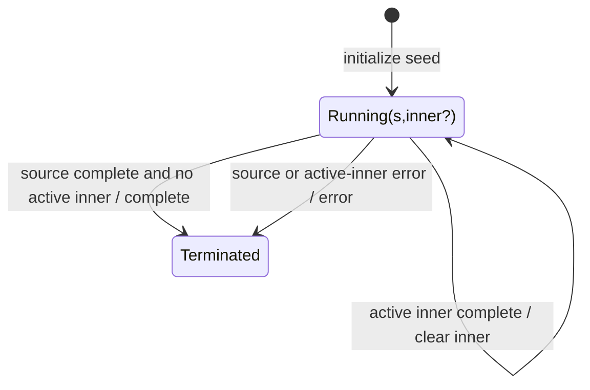

# switchScan

## Semantic essence

`switchScan` combines accumulated-state feedback with switch-style higher-order execution. A new source value replaces the previously active transition Observable; emissions from the current transition become both output and accumulated state.

## Core BDD

```text
Given accumulated state s exists
When source value v arrives
Then cancel the previous transition Observable if active
And project (s,v,index) to a new transition Observable
And subscribe to that Observable

Given the active transition emits s'
Then emit s'
And set accumulated state := s'
```

## Mealy machine



## Domain DSL

`evolveStateByLatest(...)`

## Semantic fingerprint

**state feedback + Observable transition + CANCEL previous work**
