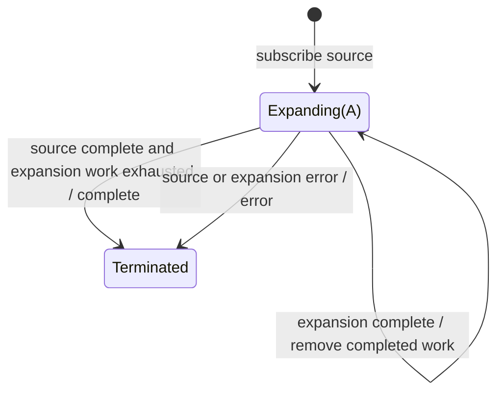

# expand

## Semantic essence

`expand` performs recursive higher-order value generation. Every emitted value is delivered downstream and projected into another Observable; generated values repeat the same process recursively.

## Core BDD

```text
Given expand is subscribed
When a source or recursively generated value v arrives
Then emit v
And apply project(v)
And admit the resulting Observable into recursive expansion

Given project(v) produces no further values
Then the recursive branch rooted at v ends
```

## Mealy machine



## Recursive model

```text
E(v) = emit(v) + expand(project(v))
```

The generated topology may be linear or branching.

## Domain DSL

`expandRecursively(project)`

Functional-programming interpretation: unfold-like recursive generation.

## Semantic fingerprint

**emit value + recursively feed generated values back into projection**
